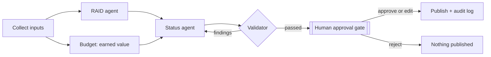

# AI Status Orchestrator

A multi-agent workflow that turns a week of raw program inputs into an approved, decision-ready status report for a transformation office. Built with **LangGraph** for orchestration and **Claude** for the language work.

It automates the operating rhythm described on my portfolio ([AI-enabled program operating rhythm](https://schnarre13.github.io/operating-rhythm.html)): status reporting, RAID upkeep and budget-versus-plan tracking. The AI does the assembly; a person makes every decision that leaves the program.

## What it does

Each week, a program manager drops in four kinds of raw input: workstream updates, a meeting transcript, budget actuals, and the current RAID log. The orchestrator then:

1. **Collects** the inputs.
2. Runs two agents **in parallel**:
   - a **RAID agent** that proposes new risks, issues, assumptions, dependencies and Value Risks, each backed by an exact quote from the sources;
   - a **budget step** that calculates earned value (CPI, SPI, variances, forecast at completion) in plain code.
3. Hands both to a **status agent** that drafts the executive report.
4. Runs a **validator** that checks every number in the draft against the sources. If anything is unsupported, the draft goes back to the status agent with the findings (up to three drafts).
5. **Pauses at a human approval gate.** The program manager approves, edits, or rejects.
6. **Publishes** the approved report, the updated RAID log, the budget metrics, and an audit log of every step.



## Design decisions

| Decision | Why |
| --- | --- |
| **Arithmetic in code, not in the model** | Language models can miscalculate. Earned value is computed deterministically, and the status agent is told to use the figures as given. |
| **RAID items must quote their source** | Every proposed item carries an exact quote. Items whose quote can't be found in the sources are dropped automatically, so the agent can't invent a risk. The quote is saved in the RAID log's `source` column, so every item stays traceable. |
| **A validator between drafting and people** | A draft with a number that doesn't appear in any source never reaches a reviewer; it's sent back for a rewrite with the specific findings. |
| **A real human gate, not a rubber stamp** | The graph stops and waits. Approve, edit, or reject; rejected drafts publish nothing. New RAID items are marked "pending owner confirmation." |
| **Everything is logged** | Each run writes an audit log of what every step did, including how many drafts it took and what the validator caught. |
| **Value Risk is a first-class RAID type** | The RAID agent flags anything that questions whether a deliverable will move the metric it was approved for. |

## Run it

Requires Python 3.10+ and a Claude API key.

```bash
python -m venv venv
venv\Scripts\activate          # Windows (on Mac/Linux: source venv/bin/activate)
pip install -r requirements.txt
copy .env.example .env         # then put your API key in .env
python main.py
```

The run prints the proposed RAID items, the validator result and the draft, then asks you to approve, edit or reject. Approved output lands in `outputs/week21/`.

## Test the guardrails (no API key needed)

The test suite swaps the model for a stub, so it checks the orchestration and the controls rather than the model:

```bash
python -m pytest -v
```

The eight tests confirm that earned value is calculated correctly, that a RAID item with an invented quote is dropped, that the validator catches an invented number, a missing section and a missing workstream, that a bad first draft is sent back and redrafted, that the run pauses for a person before anything is published, and that a rejection publishes nothing.

## Sample data

Everything in `sample_data/` is **fictional**: a 12-month enterprise AI transformation office with four workstreams and a $4.8M budget, at week 21. It matches the sample program on my portfolio. To run it on your own program, copy the folder structure and point the script at it:

```bash
python main.py --data path/to/your/week --week "Week 22"
```

## Project structure

```
main.py                        Runs the graph and the approval prompt
orchestrator/graph.py          The LangGraph workflow: nodes, parallel branches, loops, gate
orchestrator/state.py          Shared program state
orchestrator/llm.py            Claude client and helpers
orchestrator/agents/
    collector.py               Loads inputs (no AI)
    raid_agent.py              Proposes RAID items with verified evidence
    budget.py                  Earned value metrics (no AI)
    status_agent.py            Drafts and redrafts the report
    validator.py               Checks numbers, sections and coverage
    human_gate.py              Pauses for approval
    publish.py                 Writes the report, RAID log and audit log
prompts/                       The agents' instructions, kept as plain text
sample_data/week21/            Fictional inputs
tests/test_guardrails.py       Guardrail and workflow tests (no API key)
outputs/week21/                Output from a real run (after you run it)
```

## Limits

- The validator checks numbers, required sections and workstream coverage. It does not judge whether the wording is fair or the overall status is right; that's the reviewer's job.
- The sample data is small and invented. A real deployment would read from the program's actual tools (project tracker, meeting platform, finance system) through connectors.

## Author

Eric Schnarr, AI Transformation & Governance. Portfolio: https://schnarre13.github.io
